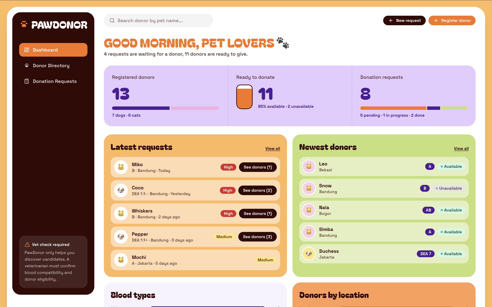
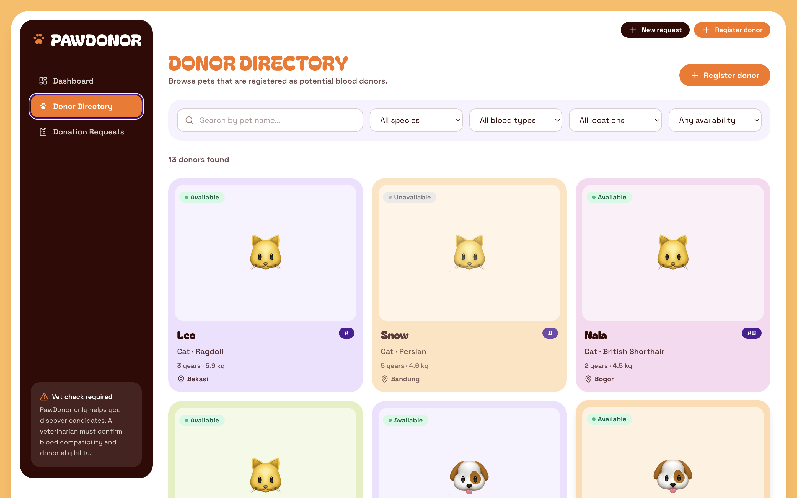
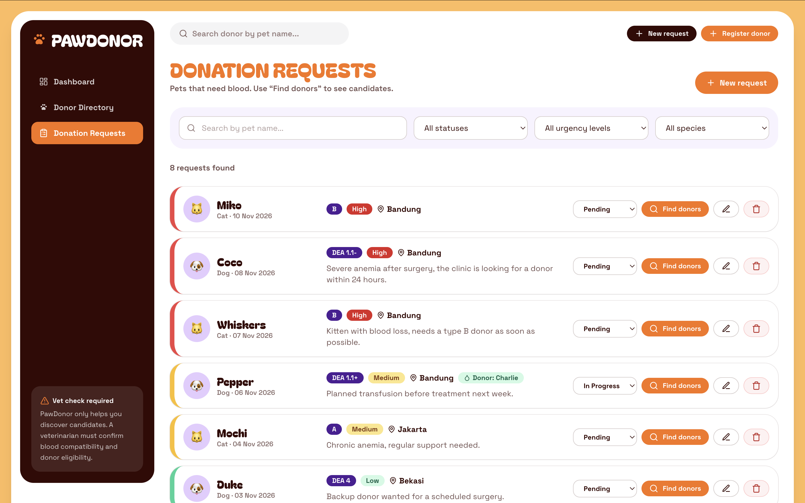

# PawDonor - Pet Blood Donor Registry

PawDonor connects pet owners who need a blood donor for their cat or dog with owners who are willing to register
their pets as potential donors. Users can register donor pets, browse and filter the directory, create blood donation
requests, and see a shortlist of matching donors for every request.

> **Medical disclaimer:** the matching feature is only for *preliminary discovery*. Final blood compatibility and donor
> eligibility must always be determined by a veterinarian.

**Category:** Web application - **Stack:** Next.js 15 (frontend + backend), PostgreSQL 16, Docker, Docker Compose
**Course:** COMP6991031 - Cloud Services (UTS), BINUS University

---

## Why this project

PawDonor was developed to make it easier for pet owners to find potential blood donors for cats and dogs. Finding suitable donors can be difficult and time-consuming
because information is often scattered across different communities and chat groups. This project provides a centralized platform to register donor pets, search for
potential donors, and manage blood donation requests. Through this project, I learned about web application development, database integration, containerization, and cloud 
deployment concepts.

## Features

- **Dashboard** - total, available and unavailable donors; total requests; recently registered donors; recent and
  open requests; blood type and location distribution.
- **Donor directory** - cards with photo, species, breed, age, weight, blood type, location and availability.
  Search by pet name; filter by species, blood type, location and availability; detail view.
- **Donor registration and management** - full CRUD (create, read, update incl. availability toggle, delete).
- **Donation requests** - full CRUD with urgency (Low / Medium / High) and status (Pending / In Progress / Completed).
- **Donor matching** - for each request, available donors of the same species with a compatible blood type,
  ranked by blood type fit and location. A donor can be selected for the request.

## Run it (Docker Compose)

Requirements: Docker with the Compose plugin (Docker Desktop or Docker Engine).

```bash
git clone <https://github.com/atthaya-khazana/PawDonor.git> pawdonor
cd pawdonor
cp .env.example .env            # Windows PowerShell: copy .env.example .env
docker compose up -d --build
```

Open **http://localhost:3002**. The database is created and filled with dummy data on the first start.

| What | URL / command |
| --- | --- |
| Application | http://localhost:3002 |
| Health check | http://localhost:3002/health |
| Status of the services | `docker compose ps` (the database must be `healthy`) |
| Logs | `docker compose logs -f app` |
| Database admin (Adminer, `tools` profile) | `docker compose --profile tools up -d`, then http://localhost:8080 |
| Stop (keeps the data) | `docker compose down` |
| Stop and DELETE the data | `docker compose down -v` |

Adminer login: System **PostgreSQL**, Server **db**, and the username / password / database from your `.env`.

Change the ports in `.env` (`APP_PORT`, `ADMINER_PORT`) if 3000 or 8080 are already in use.

### Persistence test

```bash
# 1. add a donor in the UI (or with curl, see below)
docker compose down              # removes containers + network, KEEPS the named volume
docker compose up -d             # data is still there
docker compose down -v           # removes the volume too -> next start re-creates the dummy data
```

`db/init.sql` only runs when the PostgreSQL volume is empty, which is why data added later survives
`down` / `up` but not `down -v`.

## Architecture

```
 Browser
    |  http://localhost:3002
    v
+------------------------------- Docker network: pawdonor-net (bridge) ---------------------------------+
|                                                                                                       |
|  +-------------------------+   PGHOST=db : 5432    +-----------------------+                          |
|  | app  (pawdonor-app)     | --------------------> | db  (pawdonor-db)     |   volume: pawdonor_pgdata|
|  | Next.js UI + API        |                       | postgres:16.4-alpine  | ---> /var/lib/postgresql |
|  | published 3000:3000     |                       | not published         |         /data            |
|  +-------------------------+                       +-----------------------+                          |
|                                                              ^                                        |
|  +-------------------------+   (profile "tools")             |                                        |
|  | adminer (optional)      | --------------------------------+                                        |
|  | published 127.0.0.1:8080|                                                                          |
|  +-------------------------+                                                                          |
+-------------------------------------------------------------------------------------------------------+
```

Request flow: browser -> `app` (Next.js route handler, validation) -> `pg` pool -> `db` (PostgreSQL) -> JSON back to the
browser. The app finds the database by its **service name** `db` through Docker's DNS.

## API

All endpoints return JSON. Validation errors return `400` with `{ "error": "...", "fields": { "<field>": "<message>" } }`.

| Method | Path | Success | Errors | Description |
| --- | --- | --- | --- | --- |
| GET | `/health` | 200 | 503 (database down) | App + database health check |
| GET | `/api/donors` | 200 | 400 | List donors. Query: `q`, `species`, `blood_type`, `location`, `available`, `limit` |
| POST | `/api/donors` | 201 | 400 | Register a donor |
| GET | `/api/donors/:id` | 200 | 400, 404 | One donor |
| PUT | `/api/donors/:id` | 200 | 400, 404 | Update a donor (full or partial body) |
| DELETE | `/api/donors/:id` | 204 | 400, 404 | Delete a donor |
| GET | `/api/requests` | 200 | 400 | List requests. Query: `q`, `status`, `urgency`, `species`, `limit` |
| POST | `/api/requests` | 201 | 400 | Create a request |
| GET | `/api/requests/:id` | 200 | 400, 404 | One request |
| PUT | `/api/requests/:id` | 200 | 400, 404 | Update a request (full or partial body) |
| DELETE | `/api/requests/:id` | 204 | 400, 404 | Delete a request |
| GET | `/api/requests/:id/matches` | 200 | 400, 404 | Candidate donors for a request |
| GET | `/api/stats` | 200 | - | Dashboard numbers |
| GET | `/api/locations` | 200 | - | Distinct locations (used by filters) |

```bash
curl -i http://localhost:3002/health
curl -i "http://localhost:3002/api/donors?species=Cat"

curl -i -X POST http://localhost:3002/api/donors \
  -H "Content-Type: application/json" \
  -d '{"pet_name":"Biscuit","species":"Dog","breed":"Corgi","age_years":3,"weight_kg":12.5,
       "blood_type":"DEA 4","location":"Bandung","owner_contact":"biscuit.owner@example.com","is_available":true}'

curl -i -X PUT http://localhost:3002/api/donors/1 -H "Content-Type: application/json" -d '{"is_available":false}'
curl -i http://localhost:3002/api/requests/1/matches
```

Blood types: dogs `DEA 1.1+`, `DEA 1.1-`, `DEA 1.2`, `DEA 3`, `DEA 4`, `DEA 5`, `DEA 7`; cats `A`, `B`, `AB`.

### Matching rules (simplified)

1. Same species and the donor must be **available**.
2. Blood type must be compatible: the same type is an *exact* match; additionally a DEA 1.1+ dog may receive DEA 1.1-
   blood and an AB cat may receive type A blood (*compatible*). Cat type B only matches type B.
3. Ranking: exact blood type first, then same city, then the most recently registered donor.

## Database

PostgreSQL with two relational tables, created by [`db/init.sql`](db/init.sql):

- `donors` - pet, photo, species, breed, age, weight, blood type, location, owner contact, availability.
- `donation_requests` - pet, species, blood type, location, urgency, notes, status and an optional
  `donor_id` -> `donors(id)` (`ON DELETE SET NULL`, so deleting a donor never deletes a request).

`CHECK` constraints guard species, urgency, status and the blood type per species. All data comes from the database;
the frontend has no hardcoded data. Pet photos are resized in the browser and stored as small data URLs in the
`photo_url` column (no extra file storage needed for this MVP).

## Project structure

```
app/                  Next.js App Router: pages (/, /donors, /requests), /health and /api/* route handlers
components/           UI components (shell, donor and request forms, matching modal, small ui kit)
lib/                  db pool, SQL helpers, validation, matching logic, API client, types
db/init.sql           schema + dummy data (runs on first start of the database volume)
Dockerfile            multi-stage build (builder -> runtime)
docker-compose.yml    app + db (+ adminer on the "tools" profile)
.env.example          template for .env (the real .env is never committed)
```

## Docker notes

- **Dockerfile** - two stages. `builder` installs dependencies (manifests copied first for layer caching) and runs
  `next build`; `runtime` receives only the compiled `standalone` output and static files, runs as a non-root user and
  starts with `CMD ["node", "server.js"]` (exec form). Base image: `node:22.12.0-alpine` (pinned tag).
- **docker-compose.yml** - user-defined network `pawdonor-net`, named volume `pawdonor_pgdata`, database healthcheck
  (`pg_isready`), `depends_on: condition: service_healthy`, configuration from `.env`, and Adminer on the `tools` profile.
  The database port is intentionally not published to the host.
- **Secrets** - `.env` is git-ignored and excluded from the image through `.dockerignore`. Only dummy values are in
  `.env.example`; all seed data is fictional (`example.com` contacts).

## Local development without Docker (optional)

```bash
# needs Node 20+ and a running PostgreSQL with db/init.sql applied
npm install
PGHOST=localhost PGUSER=pawdonor PGPASSWORD=... PGDATABASE=pawdonor npm run dev
```

## Screenshots

### Dashboard


### Donor Directory


### Donation Requests


## Links

- Article:
https://medium.com/@atthayaatthayas/building-pawdonor-a-pet-blood-donor-registry-with-next-js-postgresql-and-docker-fdfbe1c2dd0f?sharedUserId=atthayaatthayas
- YouTube demo: 
https://youtu.be/CvDQL8UiKZY?si=TOgozPPG_5_CL3UT

## Third-party software

[Next.js](https://nextjs.org) (MIT), [React](https://react.dev) (MIT), [Tailwind CSS](https://tailwindcss.com) (MIT),
[node-postgres](https://node-postgres.com) (MIT), fonts via [Fontsource](https://fontsource.org): Bagel Fat One and
Space Grotesk (SIL Open Font License). Project files were written by hand (no `create-next-app` template).
The visual style follows a "Pet Care" dashboard concept provided with the assignment.

## AI Usage Declaration

- **Student Name:** Atthaya Khazana
- **Tool Used:** ChatGPT & Claude AI
- **Scope of AI Usage (~20%):** Utilized for brainstorming technical workflows and consulting on Docker multi-stage build configurations, docker-compose syntax, and troubleshooting port/environment settings.
- **Human Contribution (80%):** Project selection, code review, configuring local environment parameters, running container builds, verifying healthchecks, testing API endpoints, executing data persistence tests, taking screenshots, and final report delivery.
